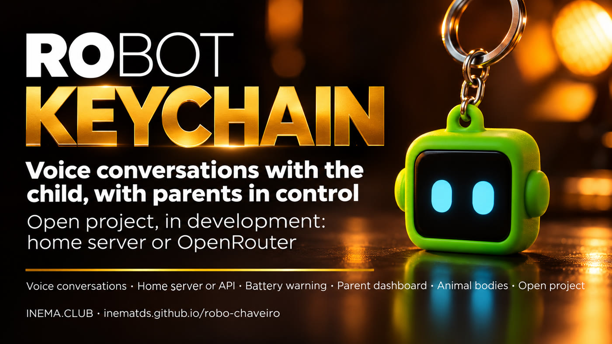

# robo-chaveiro

**🇧🇷 [Português](README.md) · 🇺🇸 [English](README.en.md) · 🇪🇸 [Español](README.es.md)**

## What it is

This is an open project to turn a small board with a 1.54" screen into a kind of pocket pet that talks by voice: the child holds down a button, speaks, and it replies out loud, with a big-eyed face on the screen. It “thinks” in one of three ways: through the home computer, directly through an online AI service (OpenRouter), or through the home computer relaying requests to that service. Parents will configure everything from a phone. For now, the project exists on paper, and the home server already works in a related project; the board and its program do not yet exist.

## 📖 User guide

Complete guide (landing page + step-by-step instructions): **https://inematds.github.io/robo-chaveiro/guia/en/**

🎬 Video: https://www.youtube.com/watch?v=735cjrp4KiM · Short: https://youtube.com/shorts/sbQqWAy1ByE

## More details

The board is the SpotPear ESP32-S3 1.54" (probably “muma,” “emo” version), purchased on AliExpress on 15/11/2026 for R$ 132,14. The home “brain” is the server that already works in [robo-cores3-lite](https://github.com/inematds/robo-cores3-lite) (option B): Whisper → `claude -p` through the subscription → Chatterbox voice. Also designed: brain A1 (directly through OpenRouter) and A2 (server as a bridge), for use away from home; a low-battery warning; the parents’ dashboard; and animal bodies with the keychain as the face. None of this has been implemented, and no API has been called.

**Status on 15/11/2026: definition only. Board on the way, no firmware.**

| For | Where |
|---|---|
| What it is, the board, safety, ideas | [DEFINICAO.md](DEFINICAO.md) |
| Phases and completion criteria | [PLANO.md](PLANO.md) |
| Project rules | [CLAUDE.md](CLAUDE.md) |
| Resume the work | [handoffs/latest.md](handoffs/latest.md) |
| Listing photos and board specs | [referencias/](referencias/) |
| Idea for later: doll and animal bodies with the keychain as the face | [ideias/corpos/PROPOSTAS.md](ideias/corpos/PROPOSTAS.md) |

## The process, from start to finish

Legend: 🧠 session with Nei · ⚙️ command/script · 🤖 `claude -p`

| # | Step | Command | Who | Exists today? |
|---|---|---|---|---|
| 1 | Read the definition and answer the open questions | [handoffs/latest.md](handoffs/latest.md) | 🧠 | yes |
| 2 | Receive the board and power it on without activating XiaoZhi | [PLANO.md](PLANO.md), F0 | 🧠 | no: board on the way |
| 3 | Check the board’s port | `arduino-cli board list` | ⚙️ | not tested: no board |
| 4 | Start the server (in the other project) | `python3 ~/projetos/robo-cores3-lite/servidor/servidor.py` | ⚙️ | yes |
| 5 | Within each turn: write the reply | `claude -p --model haiku --tools "" --strict-mcp-config --no-session-persistence …` (done by the server) | 🤖 | yes (in robo-cores3-lite) |
| 6 | Find the audio pins in the schematics and choose the board in the compiler | [PLANO.md](PLANO.md), F1 | 🧠 | no |
| 7 | Install the screen library (tell Nei first) | to be defined | ⚙️ | no |
| 8 | Write, compile, and flash the firmware | `arduino-cli compile/upload --fqbn <a definir> firmware/chaveiro` | ⚙️ | no |
| 9 | Talk at the workbench: 5 consecutive questions (brain B) | [PLANO.md](PLANO.md), F2 | 🧠 | no |
| 10 | Record the battery phrases (local Chatterbox) and test the warning without a network connection | [PLANO.md](PLANO.md), F2b | ⚙️ 🧠 | no |
| 11 | Configure from a phone (name, Wi-Fi) and set up the family dashboard (limits, history) | `python3 painel/painel.py` (to be created), port 8771; [PLANO.md](PLANO.md), F2c | ⚙️ 🧠 | no: design only |
| 12 | Key ring, case, child persona | [PLANO.md](PLANO.md), F3 | 🧠 | no |
| 13 | Brain A (A1 direct or A2 bridge), only with Nei’s written authorization | [PLANO.md](PLANO.md), F3b | 🧠 | no: design only |
| 14 | Optional features (automatic switching, tunnel, sleep, wake word, guide) | [PLANO.md](PLANO.md), F4 | 🧠 | no |
| 15 | PT/EN/ES guide on GitHub Pages | skill `projetos-landing-guia` | 🧠 | yes — [PUBLICACAO.md](PUBLICACAO.md) |
| 16 | inema.club portal, inemabuscas, and PRO catalog | skill `atualiza-portal` | 🧠 | see [PUBLICACAO.md](PUBLICACAO.md) |
| 17 | Topic in the INEMA.ROBOT Telegram group + MENU | skill `postar-telegram` | 🧠 | see [PUBLICACAO.md](PUBLICACAO.md) |
| 18 | Video on the lives6 channel and in the guide | `<!-- VIDEO: -->` marker in the guide | 🧠 | see [PUBLICACAO.md](PUBLICACAO.md) |

The only step that uses `claude -p` is step 5, handled by the robo-cores3-lite server through the subscription, without tools.

## Rules

- No external API without Nei’s explicit authorization. This includes the factory firmware’s XiaoZhi cloud service.
- Claude only through the subscription (`claude -p`).
- Public repo `inematds/robo-chaveiro` since 15/11/2026 (Nei’s instruction: publish on the portal, in INEMA.ROBOT, and on lives6).
