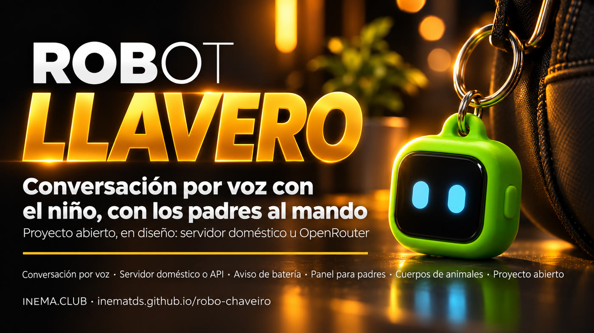

# robo-chaveiro

**🇧🇷 [Português](README.md) · 🇺🇸 [English](README.en.md) · 🇪🇸 [Español](README.es.md)**

## Qué es

Este es un proyecto abierto para transformar una plaquita con pantalla de 1,54" en una especie de mascota de bolsillo que conversa por voz: el niño mantiene presionado un botón, habla y el dispositivo responde en voz alta, con una cara de ojos grandes en la pantalla. «Piensa» de una de estas tres maneras: mediante el ordenador de casa, directamente a través de un servicio de IA en internet (OpenRouter) o mediante el ordenador de casa, que reenvía la solicitud a ese servicio. Los padres configurarán todo desde el celular. Hoy existen el proyecto sobre el papel y el servidor doméstico, que ya funciona en un proyecto hermano; la placa y su programa todavía no.

## 📖 Guía de uso

Guía completa (landing + paso a paso): **https://inematds.github.io/robo-chaveiro/guia/es/**

🎬 Video: https://www.youtube.com/watch?v=735cjrp4KiM · Short: https://youtube.com/shorts/sbQqWAy1ByE

## Más detalles

La placa es la SpotPear ESP32-S3 1,54" (probablemente «muma», versión «emo»), comprada en AliExpress el 15/11/2026 por R$ 132,14. El «cerebro» de casa es el servidor que ya funciona en
[robo-cores3-lite](https://github.com/inematds/robo-cores3-lite) (opción B): Whisper → `claude -p` mediante la suscripción → voz Chatterbox. También se diseñaron el cerebro A1 (directamente con OpenRouter) y el A2 (servidor como puente), para usarlo lejos de casa; el aviso de batería baja, el panel de los padres y cuerpos de animales con el llavero como rostro. Nada de esto está implementado y no se llamó a ninguna API.

**Estado al 15/11/2026: solo la definición. La placa está en camino; no hay firmware.**

| Para | Dónde |
|---|---|
| Qué es, la placa, seguridad, ideas | [DEFINICAO.md](DEFINICAO.md) |
| Fases y criterio de finalización | [PLANO.md](PLANO.md) |
| Reglas del proyecto | [CLAUDE.md](CLAUDE.md) |
| Retomar el trabajo | [handoffs/latest.md](handoffs/latest.md) |
| Fotos del anuncio y ficha de la placa | [referencias/](referencias/) |
| Idea para más adelante: cuerpos de muñecos y animales con el llavero como rostro | [ideias/corpos/PROPOSTAS.md](ideias/corpos/PROPOSTAS.md) |

## El proceso, de principio a fin

Leyenda: 🧠 sesión con Nei · ⚙️ comando/script · 🤖 `claude -p`

| # | Paso | Comando | Quién | ¿Existe hoy? |
|---|---|---|---|---|
| 1 | Leer la definición y responder las preguntas abiertas | [handoffs/latest.md](handoffs/latest.md) | 🧠 | sí |
| 2 | Recibir la placa y encenderla, sin activar XiaoZhi | [PLANO.md](PLANO.md), F0 | 🧠 | no: la placa está en camino |
| 3 | Comprobar el puerto de la placa | `arduino-cli board list` | ⚙️ | no probado: aún no hay placa |
| 4 | Iniciar el servidor (en el otro proyecto) | `python3 ~/projetos/robo-cores3-lite/servidor/servidor.py` | ⚙️ | sí |
| 5 | En cada turno: escribir la respuesta | `claude -p --model haiku --tools "" --strict-mcp-config --no-session-persistence …` (lo hace el servidor) | 🤖 | sí (en robo-cores3-lite) |
| 6 | Encontrar los pines de audio en los esquemas y seleccionar la placa en el compilador | [PLANO.md](PLANO.md), F1 | 🧠 | no |
| 7 | Instalar la biblioteca de pantalla (avisar a Nei antes) | por definir | ⚙️ | no |
| 8 | Escribir, compilar y cargar el firmware | `arduino-cli compile/upload --fqbn <a definir> firmware/chaveiro` | ⚙️ | no |
| 9 | Conversar en la mesa de trabajo: 5 preguntas seguidas (cerebro B) | [PLANO.md](PLANO.md), F2 | 🧠 | no |
| 10 | Grabar las frases de batería (Chatterbox local) y probar el aviso sin conexión | [PLANO.md](PLANO.md), F2b | ⚙️ 🧠 | no |
| 11 | Configurar desde el celular (nombre, Wi-Fi) y panel de la familia (límites, historial) | `python3 painel/painel.py` (por crear), puerto 8771; [PLANO.md](PLANO.md), F2c | ⚙️ 🧠 | no: solo diseño |
| 12 | Anilla, funda, personalidad infantil | [PLANO.md](PLANO.md), F3 | 🧠 | no |
| 13 | Cerebro A (A1 directo o A2 como puente), solo con autorización escrita de Nei | [PLANO.md](PLANO.md), F3b | 🧠 | no: solo diseño |
| 14 | Opcionales (cambio automático, túnel, espera, palabra de activación, guía) | [PLANO.md](PLANO.md), F4 | 🧠 | no |
| 15 | Guía PT/EN/ES en GitHub Pages | skill `projetos-landing-guia` | 🧠 | sí — [PUBLICACAO.md](PUBLICACAO.md) |
| 16 | Portal inema.club, inemabuscas y catálogo PRO | skill `atualiza-portal` | 🧠 | consultar [PUBLICACAO.md](PUBLICACAO.md) |
| 17 | Tema en el grupo INEMA.ROBOT de Telegram + MENU | skill `postar-telegram` | 🧠 | consultar [PUBLICACAO.md](PUBLICACAO.md) |
| 18 | Vídeo en el canal lives6 y en la guía | marca `<!-- VIDEO: -->` en la guía | 🧠 | consultar [PUBLICACAO.md](PUBLICACAO.md) |

El único paso con `claude -p` es el 5, que ejecuta el servidor de robo-cores3-lite mediante la suscripción, sin herramientas.

## Reglas

- Ninguna API externa sin autorización explícita de Nei. Esto incluye la nube de XiaoZhi del firmware de fábrica.
- Claude solo mediante la suscripción (`claude -p`).
- Repo público `inematds/robo-chaveiro` desde el 15/11/2026 (por orden de Nei: publicarlo en el portal, en INEMA.ROBOT y en lives6).
